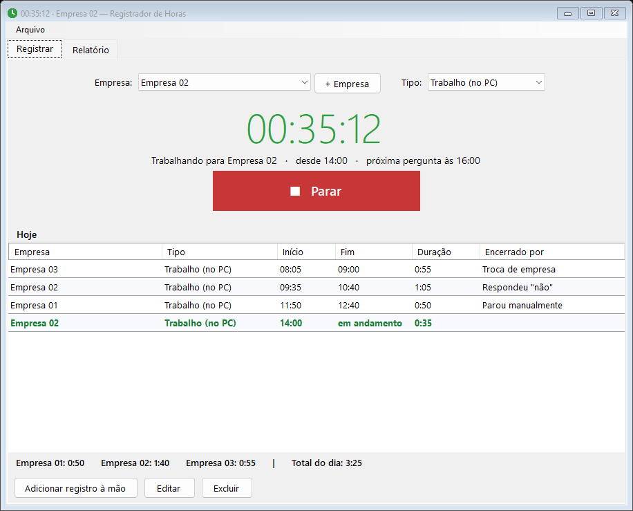
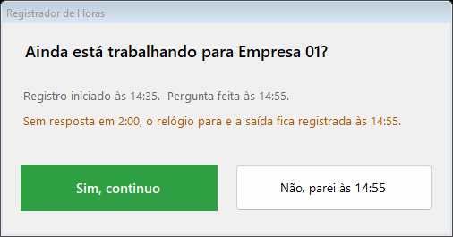
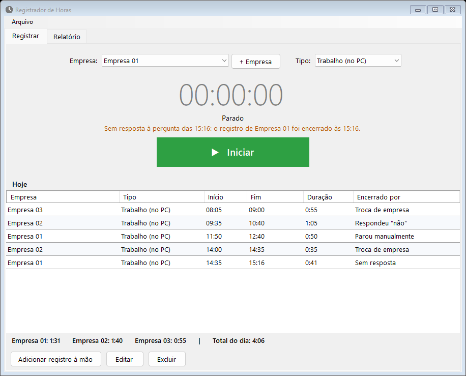
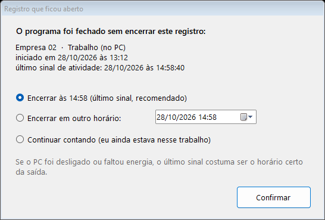
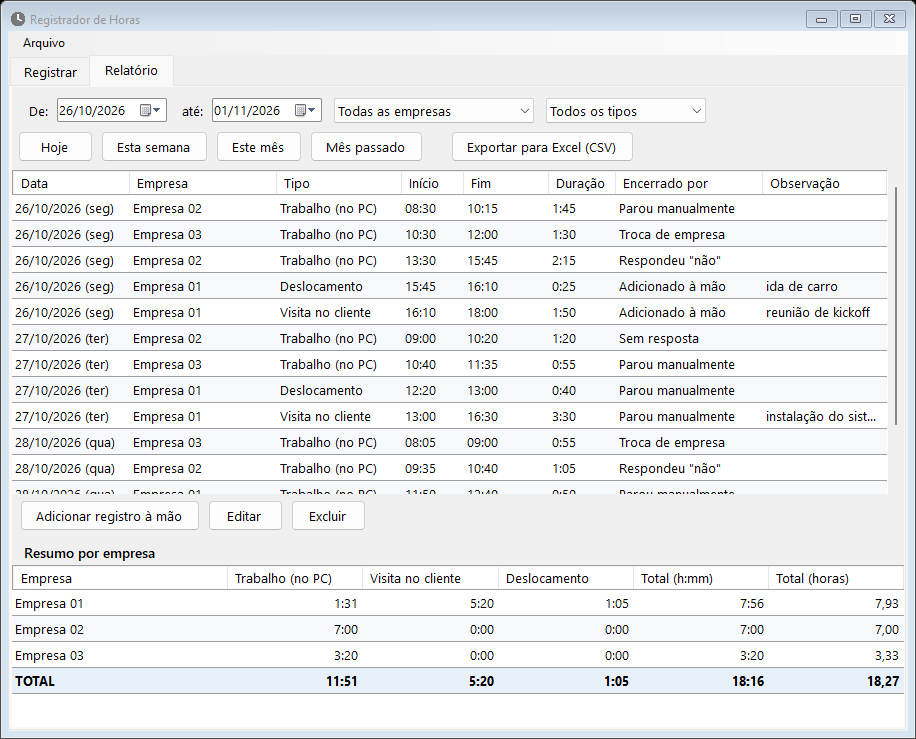

# Registrador de Horas

Registrador de tempo para **freelancers** que atendem várias empresas no mesmo dia. Você escolhe a empresa, clica em **Iniciar**, e o programa guarda cada intervalo de trabalho com hora de início e de fim, num banco SQLite, para depois montar o relatório de horas.

É um programa de Windows que vira **um único `.exe` pequeno (~74 KB)**. Não precisa instalar nada, nem .NET, nem biblioteca de banco: ele usa o .NET Framework e o SQLite que já vêm no Windows 10/11.



## O que ele faz

- **Vários intervalos por empresa, no mesmo dia.** Cada Iniciar/Parar é um registro separado, com início e fim exatos. Exemplo: Empresa 01 das 08:00 às 09:00, Empresa 02 das 09:35 às 10:40, Empresa 01 das 11:50 às 15:00.
- **Adicionar empresa é só digitar o nome.** Sem cadastro, contrato nem valor/hora.
- **Troca direta.** Com o relógio rodando, escolha outra empresa e clique em **Trocar para…**: o registro atual fecha e o novo abre no mesmo instante.
- **Roda em segundo plano.** Fechar no X só esconde a janela; o programa continua na bandeja do Windows contando e perguntando. Opcionalmente abre sozinho (escondido) quando o PC liga.
- **Pergunta "ainda está trabalhando?"** a cada 20 minutos (veja abaixo).
- **Tipos de registro:** trabalho no PC, visita no cliente e deslocamento, para quem precisa sair para atender.
- **Protege contra esquecimento e queda:** desligar o PC, suspender ou faltar energia não deixam o relógio correndo.
- **Relatório** por período, empresa e tipo, com total por empresa, exportação para Excel (CSV) e edição manual dos registros.
- **Cópia de segurança diária** do banco, mantendo as últimas 14.

## Como obter o programa

**Baixar pronto:** pegue o `RegistradorHoras.exe` na [página de Releases](https://github.com/evertongoncalo/registrador-horas/releases/latest), copie para qualquer pasta e abra. Como o arquivo não é assinado digitalmente, o Windows pode mostrar o aviso "O Windows protegeu seu PC": clique em **Mais informações** e depois em **Executar assim mesmo**. O SHA-256 de cada versão está nas notas da Release.

**Ou compilar você mesmo:** o executável não fica versionado no repositório. Para gerar o `RegistradorHoras.exe` basta rodar, na pasta do projeto:

```powershell
powershell -ExecutionPolicy Bypass -File build.ps1
```

O script usa o compilador C# que **já vem no Windows** (`csc.exe` do .NET Framework 4.8). Não é preciso instalar SDK, Visual Studio nem nada. A compilação leva poucos segundos e gera também o ícone do programa.

**Requisitos para rodar:** Windows 10 (versão 1809 ou mais nova) ou Windows 11.

## Como usar

1. Abra o `RegistradorHoras.exe`. Clique em **+ Empresa** e digite o nome.
2. Escolha a empresa e clique em **Iniciar**. O relógio começa a contar.
3. Clique em **Parar** quando terminar. Pode iniciar de novo na mesma empresa quantas vezes quiser.
4. Para ver as horas, abra a aba **Relatório**.

### A pergunta de 20 minutos

Com o relógio rodando em *Trabalho (no PC)*, a cada 20 minutos aparece uma janela por cima de tudo:



| Resposta | O que acontece |
|---|---|
| **Sim, continuo** | Segue contando; a próxima pergunta vem 20 minutos depois. |
| **Não** | O registro termina **no horário em que a pergunta apareceu**. |
| **Sem resposta** (2 min) | O relógio para e a saída também fica **no horário em que a pergunta apareceu**. |

Quando o relógio para sozinho, a tela principal explica o motivo:



Se você estava mesmo trabalhando e só não viu a pergunta, use **Adicionar registro à mão** para incluir o período. Os tempos (20 min, 2 min e 2 h) podem ser alterados em **Arquivo → Configurações**.

### Sair para o cliente

No campo **Tipo**, escolha **Visita no cliente** (ou **Deslocamento**, para o trajeto) antes de clicar em Iniciar.

- O tempo conta para a empresa visitada e aparece **separado** no relatório (colunas Trabalho, Visita e Deslocamento).
- O programa **não pergunta de 20 em 20 minutos** nesses tipos, porque você não está no PC. Pergunta só a cada 2 horas, para você não deixar ligado sem querer.
- Esqueceu de iniciar antes de sair? Use **Adicionar registro à mão** e informe empresa, tipo e horários.

### Se o PC desligar

| Situação | O que o programa faz |
|---|---|
| Desligar, reiniciar ou sair da conta do Windows | Encerra o registro na hora. |
| PC suspenso ou hibernado | Encerra o registro no momento em que dormiu. |
| Faltou energia, ou o programa foi fechado à força | Ao abrir de novo, pergunta o que fazer: encerrar no **último sinal** (recomendado), encerrar em **outro horário** ou **continuar contando**. |



Para isso o programa grava um "sinal de vida" no banco a cada 30 segundos. A coluna **Encerrado por** do relatório mostra como cada saída foi registrada (parou manualmente, sem resposta, desligamento, recuperado após queda…).

### Relatório



- Atalhos **Hoje / Esta semana / Este mês / Mês passado**, ou escolha as datas.
- Filtro por empresa e por tipo.
- O **resumo por empresa** soma trabalho, visita e deslocamento, em `h:mm` e em horas decimais (útil para cobrar).
- **Exportar para Excel (CSV)** salva a lista completa e o resumo (separador `;`, decimal com vírgula, abre direto no Excel em português).
- Dois cliques em um registro (ou **Editar** / **Excluir**) corrigem horários. O programa recusa horários que se sobreponham a outro registro.
- A duração é sempre contada **pelos horários mostrados**: 16:00 às 16:02 são 2 minutos. Assim a lista, os totais e o CSV nunca discordam.

## Onde ficam os dados

`%APPDATA%\RegistradorHoras\horas.db` (menu **Arquivo → Abrir pasta dos dados**). Cópias diárias ficam em `backup\`, mantendo as últimas 14. É um arquivo SQLite comum: dá para abrir com qualquer ferramenta de SQLite.

Parâmetros de linha de comando:

| Parâmetro | Efeito |
|---|---|
| `--bandeja` | Abre escondido, só na bandeja (é o que "Iniciar junto com o Windows" usa). |
| `--dados "<pasta>"` | Usa outra pasta para o banco (útil para testes). |

Abrir o programa de novo, com ele já rodando, não cria uma segunda cópia: só traz a janela existente para a frente.

## Como funciona por dentro

```
src/
  Program.cs     ponto de entrada, instância única, pasta de dados
  Sqlite.cs      acesso ao SQLite do Windows (winsqlite3.dll) via P/Invoke
  Store.cs       tabelas e consultas (empresas, registros, configurações, backup)
  Tracker.cs     regras do cronômetro, sem nenhuma tela
  Relatorio.cs   totais por empresa e exportação CSV
  MainForm.cs    janela principal, bandeja, eventos do Windows
  Janelas.cs     pergunta de 20 min, recuperação, empresas, configurações, edição
  Icones.cs      ícone de relógio desenhado em código
build.ps1        gera o .exe e o ícone
tests/           testes automáticos (veja abaixo)
```

**Banco.** O SQLite que acompanha o Windows (`winsqlite3.dll`) é chamado direto, sem biblioteca externa; por isso o programa continua sendo um único arquivo. Tabelas: `empresa`, `registro` e `config`. Horários são gravados como texto local `yyyy-MM-dd HH:mm:ss`. Um índice único parcial garante **no máximo um registro em andamento** (`fim IS NULL`) por vez.

**Cronômetro.** `Tracker` concentra as regras e recebe o relógio por injeção (`Clock`), o que permite testar "20 minutos" em milissegundos. A tela só chama `Tick()` uma vez por segundo e reage aos eventos `Mudou`, `Perguntar` e `Encerrado`. Além dos eventos de energia do Windows, ele detecta um salto de relógio maior que 2 minutos entre dois ticks (PC que dormiu sem avisar) e encerra no último instante em que sabia estar ligado.

**Detalhe do fechamento.** O clique no X é reconhecido pela mensagem `WM_CLOSE`, e não pelo `CloseReason` do WinForms, porque o WinForms mantém o motivo "desligamento" gravado depois de um aviso de desligamento, mesmo que ele seja cancelado depois.

**Compilador.** Como só se conta com o `csc.exe` que vem no Windows, o código usa **C# 5** (sem interpolação de strings, `?.`, membros com `=>` etc.).

## Testes

```powershell
powershell -ExecutionPolicy Bypass -File tests\run-tests.ps1
```

Compila o programa e roda três níveis de teste:

| Nível | O que cobre |
|---|---|
| **Lógica** (`LogicTest.cs`) | Banco e cronômetro com relógio simulado: pergunta aos 20 min, sim/não/sem resposta, visita sem pergunta, troca de empresa, desligamento, queda de energia, suspensão, sobreposição de horários, backup, relatório e CSV. |
| **Telas** (`UiShots.cs`) | Abre as janelas de verdade com dados de exemplo, dispara a pergunta e a falta de resposta, e salva capturas de tela. |
| **Ponta a ponta** (`e2e.ps1`) | Abre o `RegistradorHoras.exe` real e o controla por UI Automation: recuperação após queda, botão Iniciar, aviso de desligamento do Windows, fechar no X, segunda instância e início na bandeja. |

Durante os testes de tela e de ponta a ponta, janelas abrem e fecham sozinhas por alguns segundos e um som de aviso toca. Eles usam pastas de dados próprias, sem tocar nos seus dados reais nem na inicialização do Windows.

## Limitações conhecidas

- Só Windows (10 versão 1809+ ou 11).
- Só um registro por vez: não há contagem de duas empresas em paralelo.
- Os horários são locais, sem fuso horário gravado. Um registro que atravessa a meia-noite é contado no dia em que começou.
- Ao receber o aviso de desligamento o registro é encerrado na hora; se o desligamento for cancelado depois por outro programa, o registro continua encerrado.
- O executável não é assinado digitalmente; o Windows pode mostrar aviso de "editor desconhecido" se o arquivo for baixado de outro lugar.
